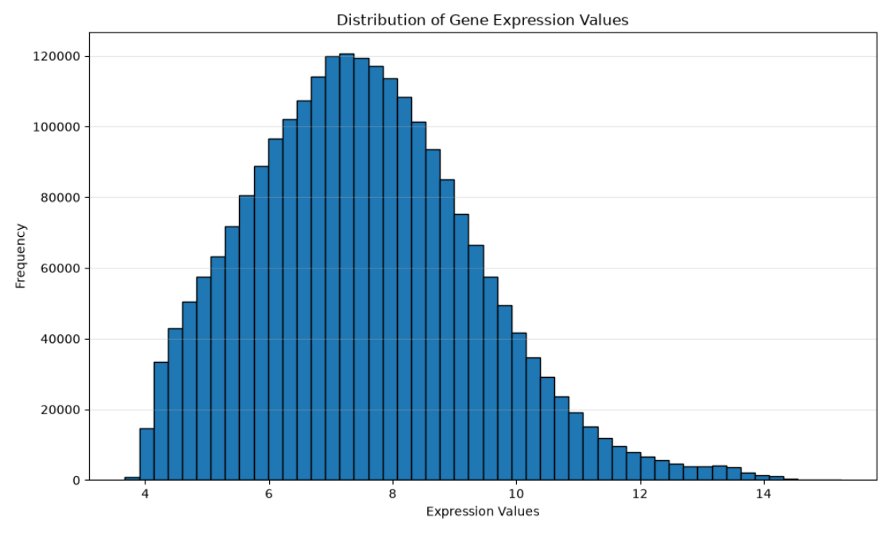
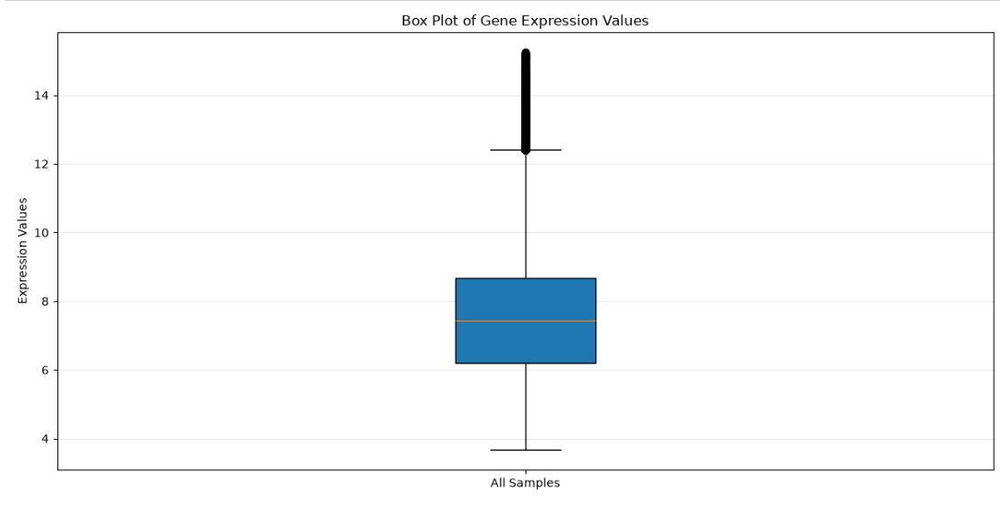
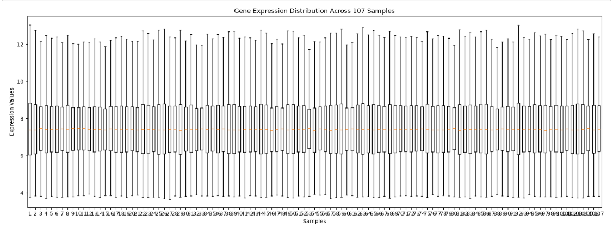
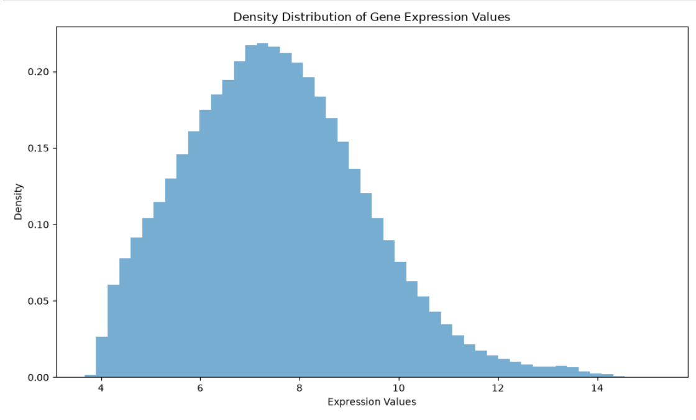
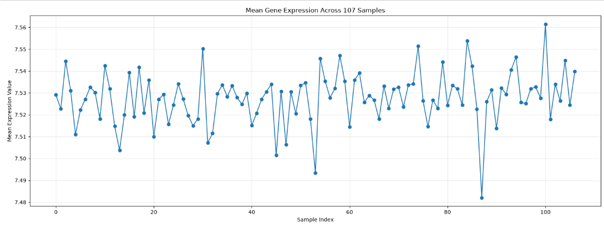
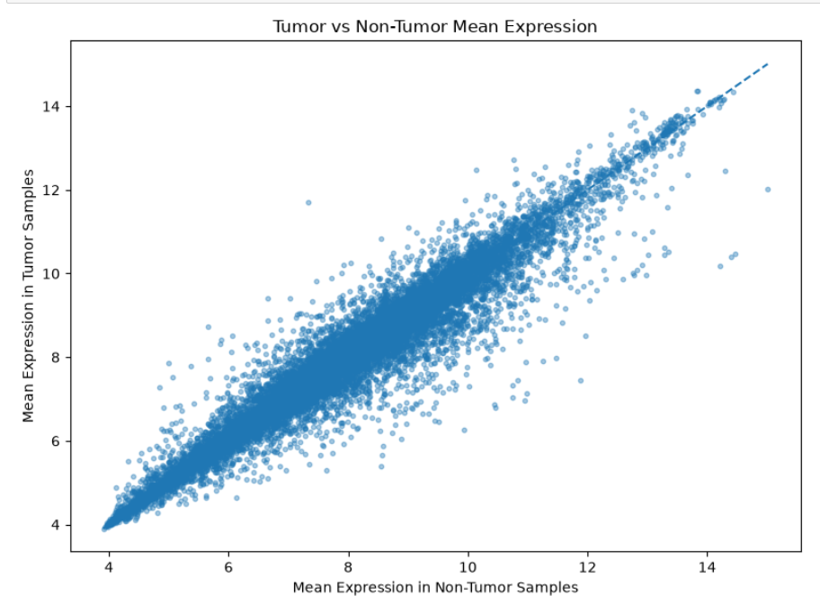

# Computational Analysis and Visualization of Gene Expression in Lung Adenocarcinoma Using the GSE10072 Dataset

## Abstract

Gene expression analysis can provide insights into molecular changes associated with diseases by examining patterns of gene activity across biological samples. This project investigated gene expression patterns associated with lung adenocarcinoma using the GSE10072 dataset obtained from the Gene Expression Omnibus (GEO).

The project involved dataset selection, data inspection, cleaning, descriptive statistical analysis, and visualization using Python. Statistical summaries were calculated to examine the distribution and variability of gene expression values. Visualizations, including histograms, boxplots, density plots, sample-wise expression plots, and tumor versus non-tumor mean expression comparisons, were used to explore the dataset.

The analysis provided an overview of expression distributions, variation among samples, and preliminary differences in average expression between tumor and non-tumor tissue groups. The findings are exploratory and do not establish statistically significant differential expression. Further statistical testing and biological interpretation are required to identify genes associated with lung adenocarcinoma.

---

# 1. Introduction

## 1.1 Background

Gene expression refers to the process through which genetic information encoded in DNA is utilized to produce functional RNA and proteins. Gene expression levels can vary depending on tissue type, environmental conditions, developmental stages, and disease states.

Studying gene expression patterns helps researchers understand biological processes and identify molecular changes associated with diseases. Computational analysis enables the examination of thousands of genes simultaneously and provides an approach to investigate disease-associated molecular patterns.

## 1.2 Lung Adenocarcinoma

Lung adenocarcinoma is a major subtype of lung cancer originating from glandular epithelial cells of the lung. Its development is associated with molecular and cellular alterations that can affect processes such as cell proliferation, survival, and regulation.

Comparing gene expression patterns between tumor and non-tumor lung tissues can help explore molecular differences associated with cancer development and progression.

## 1.3 Bioinformatics in Gene Expression Analysis

Bioinformatics combines biological knowledge with computational methods to analyze biological data. Gene expression datasets generated through technologies such as microarrays and RNA sequencing contain large amounts of biological information that require computational tools for interpretation.

Python provides libraries such as Pandas, NumPy, and Matplotlib for data handling, numerical analysis, and visualization. These tools facilitate the examination of gene expression distributions, sample variation, and potential patterns within biological datasets.

## 1.4 Project Overview

This project uses the GSE10072 gene expression dataset to explore expression patterns associated with lung adenocarcinoma.

The analysis includes dataset selection, data inspection, preprocessing, descriptive statistical analysis, visualization, and preliminary comparison of tumor and non-tumor tissue expression patterns.

The project focuses on exploratory analysis to understand the dataset and identify potential patterns for further bioinformatics investigation.

---

# 2. Research Question

**Which genes show differences in expression between lung adenocarcinoma tumor tissue and non-tumor lung tissue?**

This research question guided the computational analysis of the GSE10072 dataset. The project explored expression distributions, sample-wise variation, and preliminary differences in average expression between tumor and non-tumor groups.

The exploratory analysis provides an initial understanding of expression patterns. However, identifying statistically significant differentially expressed genes requires formal statistical testing and multiple-testing correction.

---

# 3. Aim and Objectives

## 3.1 Aim

To investigate gene expression patterns in lung adenocarcinoma tumor tissue compared with non-tumor lung tissue using computational analysis of the GSE10072 dataset.

## 3.2 Objectives

1. To select a publicly available gene expression dataset relevant to lung adenocarcinoma.
2. To inspect the structure and characteristics of the selected dataset.
3. To perform data cleaning and quality assessment using Python.
4. To calculate descriptive statistical measures to understand gene expression distribution and variability.
5. To visualize gene expression data using histograms, boxplots, density plots, and sample-wise comparisons.
6. To explore average gene expression patterns between tumor and non-tumor tissue groups.
7. To interpret the observed patterns and identify the limitations of the exploratory analysis.

---

# 4. Dataset Description

## 4.1 Dataset Source

The dataset was obtained from the Gene Expression Omnibus (GEO), a public repository maintained by the National Center for Biotechnology Information (NCBI).

The selected dataset is **GSE10072**, titled *“Gene expression signature of cigarette smoking and its role in lung adenocarcinoma development and survival.”*

The dataset was selected because it contains gene expression information relevant to lung adenocarcinoma and non-tumor lung tissue.

- **Accession number:** GSE10072
- **Database:** NCBI Gene Expression Omnibus
- **Dataset link:** https://www.ncbi.nlm.nih.gov/geo/query/acc.cgi?acc=GSE10072

## 4.2 Organism and Experimental Platform

The dataset represents gene expression data obtained from human biological samples (*Homo sapiens*).

The experiment used microarray-based gene expression profiling with the **Affymetrix Human Genome U133A Array (GPL96)**.

The processed expression matrix contains 22,283 probe identifiers representing the measured expression features included in the dataset.

## 4.3 Sample Composition

The dataset used in this project contains 107 samples consisting of lung adenocarcinoma tumor tissues and non-tumor lung tissues.

| Parameter | Value |
|---|---:|
| Total samples | 107 |
| Tumor samples | 58 |
| Non-tumor samples | 49 |
| Probe identifiers | 22,283 |
| Organism | *Homo sapiens* |
| Platform | Affymetrix Human Genome U133A |
| Platform accession | GPL96 |

The expression matrix consists of probe identifiers arranged as rows and individual samples arranged as columns. The numerical values represent processed gene expression measurements.

## 4.4 Original Study Context

The original study investigated the relationship between cigarette smoking, gene expression alterations, lung adenocarcinoma development, and patient survival.

It examined smoking-associated molecular signatures and their potential involvement in lung cancer development. The original research reported changes in cell-cycle-related genes, particularly genes associated with mitotic spindle formation.

The present project uses the dataset for exploratory comparison of gene expression patterns between tumor and non-tumor tissues rather than reproducing the complete analysis of the original publication.

---

# 5. Methodology

## 5.1 Computational Environment

The computational analysis was performed using Python in the Jupyter Notebook environment managed through Anaconda.

The following tools and libraries were used:

| Tool/Library | Purpose |
|---|---|
| Python | Programming language for computational analysis |
| Jupyter Notebook | Interactive coding and documentation |
| Pandas | Data loading, manipulation, and tabular analysis |
| NumPy | Numerical calculations and statistical operations |
| Matplotlib | Data visualization |

The project was organized into separate notebooks for data cleaning and basic analysis, and visualization and interpretation.

## 5.2 Data Acquisition and Loading

The GSE10072 gene expression dataset was downloaded from the NCBI GEO database as a series matrix file.

The dataset was loaded into a Pandas DataFrame within Jupyter Notebook. This allowed the expression measurements to be organized into a structured format for computational analysis.

The loaded data were examined to identify probe identifiers, sample columns, and the overall dimensions of the expression matrix.

## 5.3 Data Inspection and Quality Assessment

Following data loading, the dataset was inspected to understand its structure and assess its suitability for analysis.

The inspection included:

- Examining the first few rows of the dataset.
- Determining the number of rows and columns.
- Checking column names and data types.
- Examining numerical expression measurements.
- Checking for missing values.
- Inspecting sample identifiers and available sample characteristics.

These checks helped establish the structure and integrity of the dataset before further analysis.

## 5.4 Data Cleaning and Preprocessing

Data cleaning and preprocessing focused on preparing the expression matrix for statistical analysis and visualization.

The dataset was examined for missing values, data inconsistencies, and appropriate numerical data types.

Probe identifiers were maintained as row identifiers, and sample identifiers were retained as column names to preserve the structure of the expression matrix.

The expression values provided in the GEO dataset were already processed and normalized using the Robust Multi-array Average (RMA) method. Therefore, additional normalization was not performed in this project.

The preprocessing stage focused on data inspection and preparation while retaining the processed expression measurements.

## 5.5 Descriptive Statistical Analysis

Descriptive statistical analysis was performed to understand the distribution and variability of gene expression measurements.

The following statistical measures were calculated:

- Mean
- Median
- Standard deviation
- Minimum
- Maximum

Sample-wise mean expression values were also calculated to examine variation in the average expression level across individual samples.

## 5.6 Data Visualization

Data visualization was performed using Matplotlib to explore gene expression patterns.

The following visualizations were generated:

1. Histogram of overall gene expression values
2. Overall boxplot
3. Sample-wise boxplots
4. Density distribution plot
5. Sample-wise mean expression plot
6. Tumor versus non-tumor mean expression comparison

These visualizations were used to examine expression distribution, variation among samples, and preliminary differences between tumor and non-tumor groups.

## 5.7 Tumor and Non-Tumor Comparison

Samples were categorized into tumor and non-tumor tissue groups.

Mean expression values were calculated separately for each probe in the two groups. The group means were then compared to explore preliminary expression differences.

A scatter plot was generated to visualize tumor mean expression against non-tumor mean expression for individual probes.

This comparison was descriptive and was not used to establish statistical significance.

---

# 6. Results

## 6.1 Dataset Overview

The loaded expression matrix contained 22,283 probe identifiers across 107 sample columns.

The dataset contained numerical gene expression measurements and sample identifiers corresponding to individual biological samples.

The matrix was suitable for exploratory statistical analysis and visualization.

## 6.2 Descriptive Statistical Summary

The overall descriptive statistics calculated for the expression values are presented below.

| Statistical Measure | Value |
|---|---:|
| Mean | 7.527759 |
| Median | 7.426137 |
| Standard deviation | 1.816393 |
| Minimum | 3.670126 |
| Maximum | 15.248225 |

The mean and median expression values were approximately 7.53 and 7.43, respectively.

The standard deviation of approximately 1.82 indicated variation among expression measurements. The values ranged from approximately 3.67 to 15.25.

These statistics provided an overview of the central tendency and spread of expression measurements.

## 6.3 Sample-Wise Mean Expression

The sample-wise mean expression values were calculated to examine variation in average expression across the samples.

| Measure | Value |
|---|---:|
| Minimum sample mean | 7.482080 |
| Maximum sample mean | 7.561405 |
| Average of sample means | 7.527759 |
| Standard deviation of sample means | 0.012042 |

The sample-wise mean values were distributed within a relatively narrow range.

This indicated that the overall average expression level across the probes was similar among the samples. However, similarity in overall sample means does not imply that individual genes have identical expression patterns.

## 6.4 Histogram of Gene Expression Values

The histogram showed that a large proportion of expression measurements were concentrated around approximately 7–8.

The distribution extended across a broader range, with a tail toward higher expression values. This indicated that some probes had relatively higher expression measurements than the majority.

The histogram provided an overview of the overall distribution and concentration of expression values.

**Figure 1.** Distribution of gene expression values across the dataset.

## 6.5 Overall Boxplot

The overall boxplot was used to examine the median, interquartile range, spread, and potential outlying observations.

The plot showed the central distribution of expression values and observations outside the whiskers.

These observations were considered potential statistical outliers and were not automatically classified as errors.

**Figure 2.** Overall distribution and variability of gene expression values.

## 6.6 Sample-Wise Boxplots

Sample-wise boxplots were generated to compare expression distributions across all 107 samples.

The boxplots showed broadly similar overall expression distributions, although differences were visible in medians, interquartile ranges, and the presence of observations outside the whiskers.

The visualization provided an overview of sample-level variation.

Similar overall distributions do not necessarily indicate similar expression of individual genes between tumor and non-tumor tissues.

**Figure 3.** Distribution of gene expression values across the 107 samples.

## 6.7 Density Distribution

The density plot showed a concentration of expression values around approximately 7–8.

It provided a smooth representation of the distribution and complemented the histogram by illustrating the region where expression measurements were most concentrated.

**Figure 4.** Density distribution of gene expression values across the dataset.

## 6.8 Sample-Wise Mean Expression Plot

The sample-wise mean expression plot showed average expression values within a relatively narrow range of approximately 7.48–7.56.

The small variation in sample means suggested that the overall average expression level was relatively consistent across samples.

However, this result reflects averages across all probes and does not indicate that the expression of individual probes was consistent.

**Figure 5.** Mean gene expression values across individual samples.

## 6.9 Tumor Versus Non-Tumor Mean Expression

Mean expression values were calculated separately for tumor and non-tumor samples for each probe identifier.

The scatter plot compared tumor mean expression against non-tumor mean expression.

Points above or below the diagonal represented probes with relatively higher mean expression in one group, while points close to the diagonal represented probes with similar average expression between the groups.

The visualization showed preliminary differences in average expression for some probes, while others appeared to have relatively similar expression values.

These observations were exploratory and were not tested for statistical significance.

**Figure 6.** Comparison of mean gene expression values between tumor and non-tumor tissue samples.

---

# 7. Discussion

The exploratory analysis provided an overview of gene expression patterns in the GSE10072 dataset.

The descriptive statistics showed that expression values were concentrated around an overall mean of approximately 7.53 and median of approximately 7.43. The standard deviation indicated variation across probe-level measurements.

The histogram and density plot demonstrated the concentration of expression values around approximately 7–8, while the boxplot illustrated the overall spread and potential outlying observations.

The sample-wise boxplots and sample-wise mean plot showed broadly similar overall expression distributions among samples. The sample means varied within a relatively narrow range.

However, similarity in overall expression distributions does not necessarily indicate that individual genes have similar expression levels between tumor and non-tumor tissue.

The tumor versus non-tumor comparison provided an exploratory overview of expression differences between the tissue groups. Some probes showed relatively higher average expression in tumor tissue, while others showed relatively higher average expression in non-tumor tissue.

These patterns may provide candidates for further investigation. However, statistical testing is required to determine whether these differences are significant and whether they remain meaningful after correction for multiple comparisons.

The project demonstrates the usefulness of computational analysis and visualization as initial steps in exploring biological datasets and generating hypotheses for further research.

---

# 8. Limitations

The project has several limitations:

1. **Exploratory analysis:** The analysis primarily involved descriptive statistics and visualization. Statistical significance was not established.

2. **No formal differential expression testing:** Individual probes were not evaluated using a formal differential expression testing framework.

3. **No multiple-testing correction:** Since thousands of probes were included, further statistical analysis would require correction for multiple comparisons.

4. **Probe-level analysis:** The analysis primarily used probe identifiers. Additional annotation would be required to map probes to gene symbols and biological functions.

5. **Limited biological interpretation:** Gene-level biological functions, pathway analyses, and enrichment analyses were not performed.

6. **Potential confounding factors:** Smoking history and other sample characteristics may influence gene expression. These factors were not incorporated into the exploratory comparison.

7. **Outlier interpretation:** Potential outlying observations were identified visually but were not individually investigated for biological or technical significance.

8. **Dataset-specific findings:** The analysis was based on one dataset, and the results may not necessarily generalize to other populations or studies.

---

# 9. Conclusion

This project explored gene expression patterns associated with lung adenocarcinoma using the GSE10072 dataset.

The workflow included dataset selection, data loading, inspection, preprocessing, descriptive statistical analysis, and visualization using Python.

The analysis provided an overview of expression distributions, sample-level variation, and preliminary differences in average expression patterns between tumor and non-tumor tissue groups.

The visualizations demonstrated the usefulness of exploratory data analysis in understanding gene expression datasets and identifying potential patterns for further investigation.

Although preliminary differences in expression were observed between the tissue groups, statistically significant differentially expressed genes were not established.

Further analysis using formal differential expression testing, multiple-testing correction, probe annotation, and pathway enrichment analysis would be necessary to identify and interpret biologically significant molecular changes associated with lung adenocarcinoma.

Overall, the project provided practical experience in computational bioinformatics, data handling, statistical analysis, visualization, and scientific interpretation of biological datasets.

---

# 10. Future Work

Future analysis could extend this project through:

- Formal differential expression analysis between tumor and non-tumor tissues.
- Multiple-testing correction to identify statistically significant probes.
- Mapping probe identifiers to gene symbols and gene annotations.
- Identification of upregulated and downregulated genes.
- Gene Ontology enrichment analysis.
- Pathway analysis to investigate biological processes associated with lung adenocarcinoma.
- Exploration of smoking status and other sample characteristics.
- Validation using independent gene expression datasets.

These approaches would provide deeper biological interpretation of the observed expression patterns.

---

# 11. References

1. Landi MT, Dracheva T, Rotunno M, et al. **Gene expression signature of cigarette smoking and its role in lung adenocarcinoma development and survival.** *PLoS ONE.* 2008;3(2):e1651.  
   https://doi.org/10.1371/journal.pone.0001651

2. National Center for Biotechnology Information (NCBI). **Gene Expression Omnibus: GSE10072.**  
   https://www.ncbi.nlm.nih.gov/geo/query/acc.cgi?acc=GSE10072

3. National Center for Biotechnology Information (NCBI). **BioProject PRJNA108637: Gene expression signature of cigarette smoking and its role in lung adenocarcinoma development and survival.**  
   https://www.ncbi.nlm.nih.gov/bioproject/108637

4. McKinney W. **Data Structures for Statistical Computing in Python.** Proceedings of the 9th Python in Science Conference. 2010.

5. Harris CR, Millman KJ, van der Walt SJ, et al. **Array programming with NumPy.** *Nature.* 2020;585:357–362.  
   https://doi.org/10.1038/s41586-020-2649-2

6. Hunter JD. **Matplotlib: A 2D Graphics Environment.** *Computing in Science & Engineering.* 2007;9(3):90–95.  
   https://doi.org/10.1109/MCSE.2007.55

---

## Project Repository

GitHub: https://github.com/naheedmomin/SWYNEX-Bioinformatics-Project
